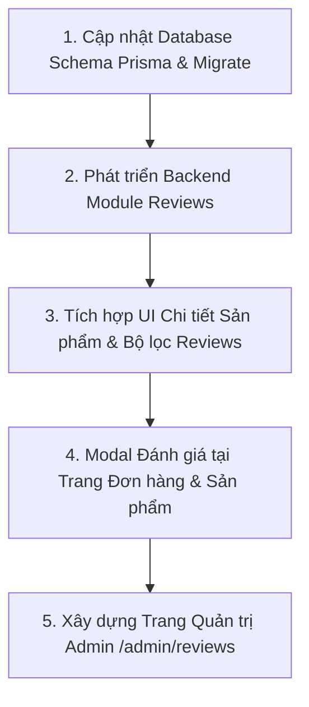

# Tài liệu Đặc tả Thiết kế Hệ thống Đánh giá (Review & Rating System)

> **Dự án**: Fashion Shop — Nền tảng E-commerce Thời trang  
> **Phiên bản thiết kế**: 1.0  
> **Trạng thái**: Đã thống nhất qua Grill-Me Interview

---

## 1. Tổng quan & Phạm vi (Scope)

Hệ thống tập trung vào **Đánh giá sau khi mua hàng (Verified Purchase Reviews)** nhằm nâng cao độ uy tín, cung cấp trải nghiệm mua sắm chân thực và hỗ trợ khách hàng chọn đúng kích cỡ:

* **Điều kiện đánh giá**: Chỉ tài khoản đã mua sản phẩm và đơn hàng ở trạng thái `COMPLETED`.
* **Ràng buộc**: Mỗi mặt hàng trong đơn (`OrderItem`) chỉ được đánh giá tối đa 1 lần.
* **Thời gian chỉnh sửa**: Cho phép khách cập nhật lại đánh giá trong vòng 30 ngày kể từ ngày gửi.
* **Quy trình duyệt**: Tự động công khai (`APPROVED`). Admin có quyền Ẩn/Hiện (`HIDDEN`).
* **Tương tác**: Shop có thể phản hồi trực tiếp (Seller Reply) và người dùng khác có thể bấm "Hữu ích" (Helpful Vote).

---

## 2. Thiết kế Cơ sở Dữ liệu (Prisma Schema)

### 2.1. Cập nhật Model `Product` (Cache chỉ số)
Để tránh tính toán `AVG()` và `COUNT()` mỗi khi load danh sách sản phẩm hoặc chi tiết sản phẩm:
```prisma
model Product {
  // ... các trường hiện tại ...
  ratingAverage    Decimal          @default(0) @map("rating_average") @db.Decimal(3, 2)
  reviewCount      Int              @default(0) @map("review_count")
  reviews          Review[]
}
```

### 2.2. Model `Review` & `ReviewLike`
```prisma
enum ProductFit {
  TIGHT         // Hơi chật
  TRUE_TO_SIZE  // Chuẩn size
  LOOSE         // Hơi rộng
}

enum ReviewStatus {
  APPROVED      // Hiển thị công khai
  HIDDEN        // Bị admin ẩn (vi phạm chính sách)
}

model Review {
  id              Int             @id @default(autoincrement())
  productId       Int             @map("product_id")
  userId          Int             @map("user_id")
  orderId         Int             @map("order_id")
  orderItemId     Int             @unique @map("order_item_id") // 1-1 với OrderItem

  rating          Int             // 1 đến 5 sao
  content         String?         // Nhận xét chi tiết
  images          String[]        @default([]) // URLs tối đa 5 ảnh feedback

  // Chỉ số đặc thù thời trang
  fit             ProductFit?     // TIGHT, TRUE_TO_SIZE, LOOSE
  userHeight      Int?            @map("user_height") // cm (Ví dụ: 165)
  userWeight      Int?            @map("user_weight") // kg (Ví dụ: 55)

  // Phản hồi từ Shop
  replyContent    String?         @map("reply_content")
  repliedAt       DateTime?       @map("replied_at")
  repliedBy       Int?            @map("replied_by")

  // Tương tác & Trạng thái
  likesCount      Int             @default(0) @map("likes_count")
  status          ReviewStatus    @default(APPROVED)

  createdAt       DateTime        @default(now()) @map("created_at")
  updatedAt       DateTime        @updatedAt @map("updated_at")

  product         Product         @relation(fields: [productId], references: [id], onDelete: Cascade)
  user            User            @relation(fields: [userId], references: [id], onDelete: Cascade)
  order           Order           @relation(fields: [orderId], references: [id], onDelete: Cascade)
  orderItem       OrderItem       @relation(fields: [orderItemId], references: [id], onDelete: Cascade)
  likes           ReviewLike[]

  @@index([productId, status, createdAt])
  @@index([userId])
  @@index([orderId])
  @@map("reviews")
}

model ReviewLike {
  id        Int      @id @default(autoincrement())
  reviewId  Int      @map("review_id")
  userId    Int      @map("user_id")
  createdAt DateTime @default(now()) @map("created_at")

  review    Review   @relation(fields: [reviewId], references: [id], onDelete: Cascade)
  user      User     @relation(fields: [userId], references: [id], onDelete: Cascade)

  @@unique([reviewId, userId])
  @@map("review_likes")
}
```

---

## 3. Kiến trúc API Backend (NestJS Module `reviews`)

Module mới tại `fashion-shop-be/src/modules/reviews/`:

### 3.1. Public & Customer APIs
* `GET /api/products/:productId/reviews`
  * Query: `page`, `limit`, `rating` (1-5), `hasImages` (boolean), `fit` (TIGHT, TRUE_TO_SIZE, LOOSE), `sort` (`newest`, `highest`, `lowest`, `most_helpful`).
  * Trả về: Danh sách reviews, phân bố sao (số lượng 5*, 4*, 3*, 2*, 1*), tỷ lệ Fit %, và điểm TB.
* `GET /api/products/:productId/review-eligibility` *(Yêu cầu Auth)*
  * Kiểm tra xem user hiện tại có đơn hàng `COMPLETED` nào chứa sản phẩm này mà chưa đánh giá không (trả về danh sách `orderItemId` đủ điều kiện).
* `POST /api/reviews` *(Yêu cầu Auth)*
  * Body: `orderItemId`, `rating` (1-5), `content`, `images` (string[]), `fit`, `userHeight`, `userWeight`.
  * Validate: Đơn hàng thuộc sở hữu của user, trạng thái = `COMPLETED`, `orderItemId` chưa từng được review.
  * Trigger: Tự động cập nhật `ratingAverage` & `reviewCount` của `Product`.
* `PUT /api/reviews/:id` *(Yêu cầu Auth)*
  * Cho phép sửa rating, content, images, fit trong vòng 30 ngày kể từ `createdAt`.
* `POST /api/reviews/:id/like` *(Yêu cầu Auth)*
  * Toggle Like / Bỏ Like đánh giá hữu ích.

### 3.2. Admin & Staff APIs
* `GET /api/admin/reviews`
  * Bộ lọc: `search` (theo tên user, nội dung, mã đơn), `productId`, `rating`, `status`, `hasReply`.
* `PATCH /api/admin/reviews/:id/status`
  * Thay đổi trạng thái: `APPROVED` ↔ `HIDDEN`.
* `POST /api/admin/reviews/:id/reply`
  * Thêm hoặc cập nhật phản hồi của Shop cho review.

---

## 4. Trải nghiệm Giao diện (Frontend Next.js)

### 4.1. Trang Chi tiết Sản phẩm (`/products/[id]`)
1. **Khối Thống kê Tổng quan (Rating Overview Card)**:
   * Điểm trung bình (VD: `4.9 / 5.0`), số sao dạng visual.
   * Thanh Progress Bar thể hiện tỷ lệ phần trăm theo từng mức sao (5⭐, 4⭐, 3⭐, 2⭐, 1⭐).
   * Badge tổng kết vóc dáng thời trang: *"88% khách nhận xét form vừa vặn chuẩn size"*.
   * Bộ lọc nhanh (Tags): `[Tất cả]`, `[Có hình ảnh (42)]`, `[5 sao (110)]`, `[Form chuẩn size (95)]`.
2. **Banner / Nút Viết Đánh giá**:
   * Nếu user đã mua sản phẩm này trong đơn hoàn tất chưa review: Hiển thị banner *"Bạn đã mua sản phẩm này. Hãy chia sẻ cảm nhận để nhận lời cảm ơn từ shop! [Đánh giá ngay]"*.
3. **Danh sách Đánh giá (Review Card)**:
   * Thông tin người mua: Tên (hỗ trợ ẩn danh định dạng `N***g`), Avatar, Badge *"Đã mua hàng"*.
   * Phân loại đã mua: Hiển thị badge màu sắc & size (VD: *Màu Đen / Size L*).
   * Thông số vóc dáng: *1m68 • 58kg • Vừa vặn chuẩn size*.
   * Grid ảnh feedback: Click để mở Lightbox xem ảnh to.
   * Phản hồi từ Shop: Khung màu xám nhạt trang nhã với icon và logo Shop.
   * Nút bấm *"Hữu ích (n)"* có icon bàn tay/tim.

### 4.2. Trang Chi tiết Đơn hàng (`/orders/[id]`)
* Với đơn hàng `COMPLETED`, bên cạnh mỗi Order Item:
  * Nút **"Đánh giá"** (màu nổi bật) nếu chưa review.
  * Nút **"Xem / Sửa đánh giá"** (kèm thời hạn còn lại trong 30 ngày) nếu đã review.
* **Modal Đánh giá chuẩn UX**:
  * Đánh giá 1-5 sao bằng icon Star tương tác hover mượt mà.
  * Chọn độ vừa vặn: 3 lựa chọn nút bấm (Hơi chật / Chuẩn size / Hơi rộng).
  * 2 ô input số nhỏ: Chiều cao (cm), Cân nặng (kg).
  * Textarea cảm nhận chất vải, form dáng, độ bền màu.
  * Khu vực upload tối đa 5 ảnh feedback thực tế (sử dụng component upload đã có).

### 4.3. Trang Quản trị Admin (`/admin/reviews`)
* Thống kê thẻ: Điểm TB toàn shop, Tổng lượt đánh giá, Đánh giá chưa phản hồi, Đánh giá bị ẩn.
* Bảng danh sách reviews với phân trang, search, lọc theo trạng thái và số sao.
* Hành động:
  * Modal Trả lời khách hàng (Reply).
  * Nút chuyển đổi nhanh trạng thái Ẩn / Hiện (Switch toggle).

---

## 5. Kế hoạch Triển khai (Step-by-step Roadmap)



1. **Bước 1 — Prisma Schema & Database Migration**:
   * Bổ sung `ratingAverage`, `reviewCount` vào `Product`.
   * Tạo model `Review`, `ReviewLike` và các enums `ProductFit`, `ReviewStatus`.
   * Chạy `npm run prisma:migrate`.
2. **Bước 2 — Backend NestJS Module (`reviews`)**:
   * DTOs: `CreateReviewDto`, `UpdateReviewDto`, `QueryReviewsDto`, `ReplyReviewDto`.
   * Controller, Service với logic tính lại rating trung bình atomic, kiểm tra quyền sở hữu đơn hàng `COMPLETED`.
   * Thêm module vào `AppModule`.
3. **Bước 3 — Frontend: Review Section trên Trang Sản phẩm**:
   * Tạo component `ProductReviewSummary`, `ProductReviewList`, `ReviewItem`, `ReviewImageModal`.
   * Hook React Query `useReviews`, `useReviewEligibility`.
4. **Bước 4 — Frontend: Modal Gửi / Sửa Đánh giá**:
   * Tạo `ReviewFormModal` dùng chung tại trang `/orders/[id]` và `/products/[id]`.
   * Tích hợp upload ảnh feedback qua API `/api/upload`.
5. **Bước 5 — Frontend: Trang Quản trị Admin (`/admin/reviews`)**:
   * Bảng quản lý đánh giá chuẩn Enterprise UI, hỗ trợ Reply và Ẩn/Hiện.
   * Thêm menu Review vào Sidebar Admin.
